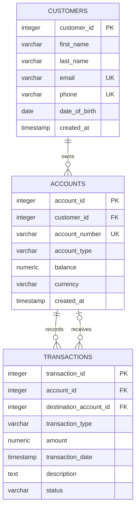

# FlexPay Financial Technologies
## Entity Relationship Diagram (ERD)

## Relationship Explanation

1. **Customers and Accounts:** One customer can own multiple accounts, but each account belongs to one customer.
2. **Accounts and Transactions:** One account can originate many transactions, but each transaction has one originating account.
3. **Destination Accounts:** An account can receive many transfers. Each transaction may have zero or one destination account. External transfers and deposits or withdrawals do not require a destination account.